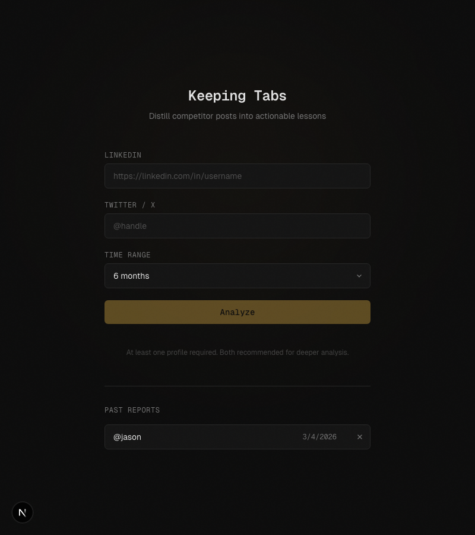

# Keeping Tabs

Competitive intelligence tool that pulls posts from LinkedIn and Twitter/X, runs them through an LLM, and distills them into a structured report of actions, strategies, and takeaways.



## What it does

1. Enter a LinkedIn profile URL and/or Twitter handle
2. Select a time range (3 months to 2 years)
3. The tool fetches all their posts, then uses Gemini Flash to extract:
   - **Actions & Results** -- what they did and what happened
   - **Strategies & Patterns** -- recurring approaches
   - **What's Working** -- successful tactics
   - **What Failed / Pivots** -- challenges and course corrections
   - **Key Takeaways** -- top actionable lessons

Each insight links back to the original source post.

## Stack

- **Next.js 16** (App Router, TypeScript)
- **RapidAPI** for LinkedIn post data
- **SocialData.tools** for Twitter/X data
- **OpenRouter** (Gemini 3 Flash) for LLM analysis
- **File-based storage** (JSON in `data/reports/`)
- Deployed on **Dokku** via Docker

## Setup

```bash
cp .env.example .env
# Fill in your API keys

bun install
bun run dev
```

## Environment variables

| Variable | Description |
|---|---|
| `RAPIDAPI_KEY` | RapidAPI key for LinkedIn data |
| `SOCIALDATA_API_KEY` | SocialData.tools API key for Twitter/X |
| `OPENROUTER_API_KEY` | OpenRouter API key |
| `ACCESS_KEY` | Simple password protection key (optional) |

## Access control

The app is gated behind a simple key. Visit with `?key=your-secret` to unlock -- the key is saved to localStorage so you don't need it again.
